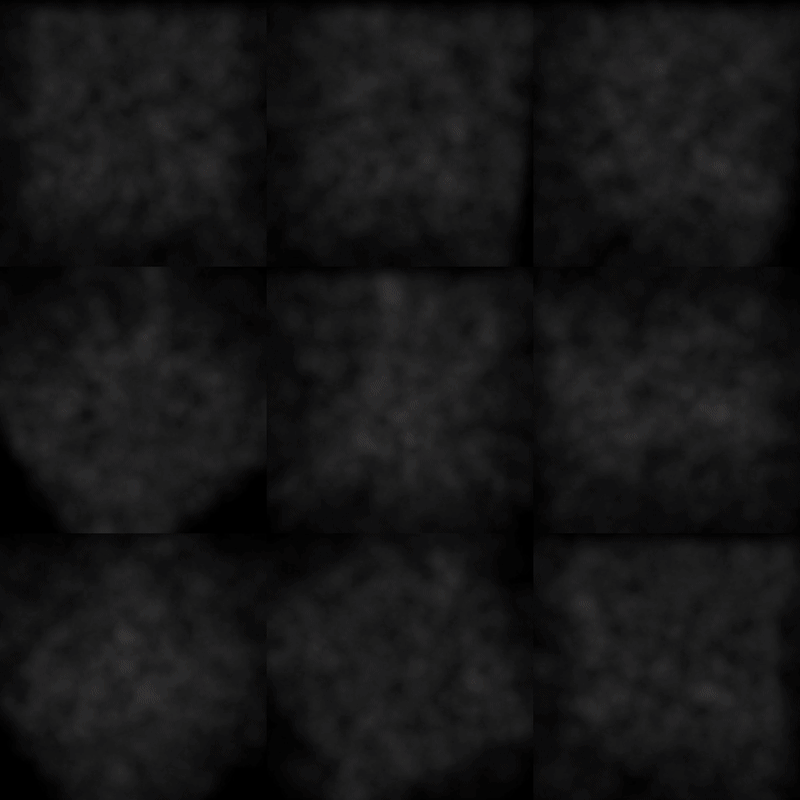
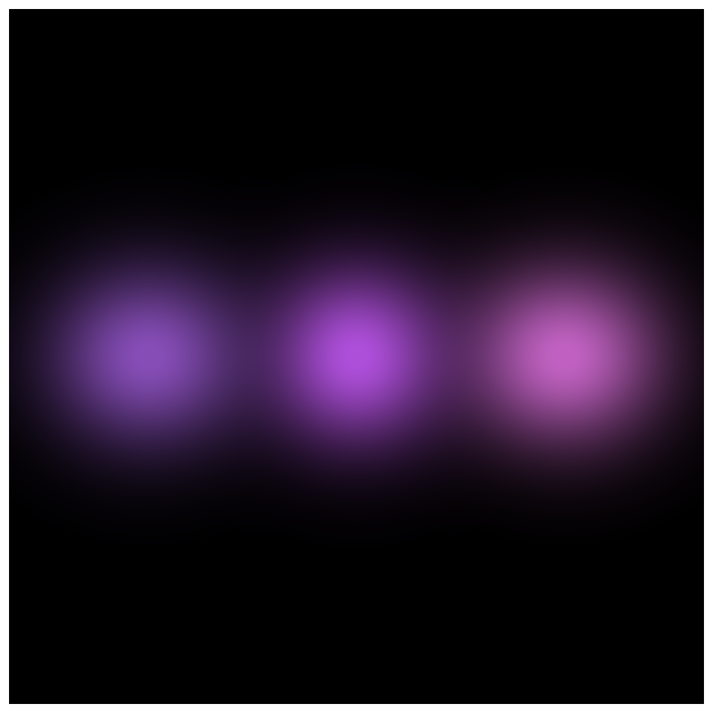

# 3D Gaussian Splatting in Python with NVIDIA Warp

This project reimplements the core ideas of 3D Gaussian Splatting in a clean, minimalist Python codebase using NVIDIA Warp. It runs on both CPU and GPU with no CUDA setup, focuses on clarity and parallelism, and is designed as a practical entry point for learning modern graphics and differentiable rendering.

[Read the walkthrough: from 3D Gaussians to a trainable image](docs/gaussian-splatting-from-scratch.md) · [Website version](https://guoriyue.github.io/blog/3dgs-warp-from-scratch/)

## Why This Implementation?

### ✅ CPU & GPU with Zero Hassle

Thanks to Warp, the same kernel code runs seamlessly on both CPU and GPU — no need to deal with CUDA setup, driver issues, or device-specific kernels. Just flip one config line.

### 🧠 Learn Modern Graphics the Easy Way

Explore differentiable rendering and parallel graphics through clean, readable Python — no pricey GPUs, complex toolchains, or heavy C++/CUDA boilerplate needed.

### 📦 Minimalist & Educational

This isn’t another massive codebase. It’s designed for clarity and experimentation. Strips away complexity so you can focus on understanding how Gaussian Splatting really works.



## Quick Start

### Installation

```bash
# Clone the repository
git clone https://github.com/guoriyue/3dgs-warp-scratch.git
cd 3dgs-warp-scratch

# Install dependencies
pip install warp-lang==1.7.0 numpy==1.26.4 matplotlib==3.9.2 imageio==2.34.1 tqdm==4.66.5 plyfile torch==2.6.0
```

### Download Example Data

```bash
# Download the Lego dataset
bash download_example_data.sh
```


### Rendering

```bash
# Render 3 Gaussian points – a minimalist example
python render.py
```
You should see 3 Gaussian points like:



### Training

```bash
# Train on Lego dataset (CPU by default)
# For GPU training, change DEVICE in config.py to "cuda"
python train.py
```


## Project Structure

```
├── forward.py                # 3DGS: Forward pass (reimplementation of graphdeco-inria/gaussian-splatting)
├── backward.py               # 3DGS: Backward pass (reimplementation of graphdeco-inria/gaussian-splatting)

├── train.py                  # Main training loop
├── render.py                 # Rendering script to validate outputs; confirms forward pass correctness
├── config.py                 # Configuration and training parameters


├── loss.py                   # Loss functions for training (includes depth loss, though unused in this repo)
├── scheduler.py              # Learning rate scheduler
├── optimizer.py              # Adam optimizer and densify & prune logic

├── utils/
│   ├── camera_utils.py       # Load camera intrinsics and extrinsics from training data
│   ├── point_cloud_utils.py  # Point cloud I/O utilities (e.g., saving to .ply)
│   ├── math_utils.py         # General math utilities (e.g., transformation matrices)
│   └── wp_utils.py           # Warp utilities for math operations and device transfer

└── data/                     # Contains the NeRF-synthetic 'Lego' dataset

```

`forward.py` and `backward.py` are based on [graphdeco-inria/gaussian-splatting](https://github.com/graphdeco-inria/gaussian-splatting). The original pure CUDA version is now reimplemented in Nvidia Warp, easy to understand, set up, and run.

Densification and pruning logic is based on [yzslab/gaussian-splatting-lightning](https://github.com/yzslab/gaussian-splatting-lightning), but restructured here with minimal data preparation and simplified training logic.

## License

This project is licensed under the **GNU Affero General Public License v3.0**.  
See the [LICENSE](./LICENSE) file for details.